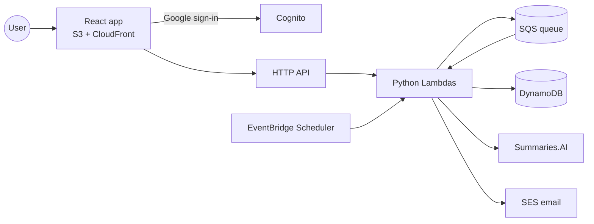

# diet-tracker

A Hebrew web app for following an existing weight-loss program day by day, open to anyone
with a Google account; it is an independent tracker inspired by the program, not part of it. The
program judges a day by the character of its meals and the gaps between them, not by calories,
and as in golf a lower score is better. You log each meal as you eat it; the app scores the day,
charts the trend, mails reminders and answers questions about the program.

**[Walk through a tracked day](https://dwyjxouhdjlxp.cloudfront.net/demo.html)** — an animated
replay of one session on a phone screen: sign-in, three meals logged as they happen, the day
closed from the tracker, and the week's trend over recorded history.

**Contents:** [Overview](#overview) · [Tech stack](#tech-stack) · [Architecture](#architecture) ·
[Getting started](#getting-started) · [Scripts](#scripts) · [Details](#details) ·
[License](#license)

## Overview

- **Four principles** carry the program: drinking enough **water**, **vegetables** in your meals,
  a short **eating window**, and **few meals** a day. Their Hebrew initials spell **שכפ"צ**, army
  slang for body protection.
- **Each meal is logged as it is eaten**: carb source and helping, vegetables, fruit, fat servings
  and side items such as a sweet or a drink. It costs points for its carb source, helping and side
  items, and the day's score is their sum; a day of 12 points or more is a heavy day. Fat is
  budgeted rather than scored, and a day past three fat servings is marked. The log answers three
  principles by itself, so closing the day asks only for the water; one confirmation reopens it.
- A 10-day **trend chart** and a table of recorded days mark every day that crossed a limit.
  **Weight** is tracked by a weekly weigh-in against a target you set; it is measured rather than
  scored, so it changes no day's score and raises no alert.
- An **in-app chat** answers questions from the program's documents, citing them, through a
  separate service, [Summaries.AI](https://github.com/erancha/Summaries.AI-public). Each question
  also sends your recent days and meals, so that data leaves this app. A chat you share is
  readable by every other user, under your email address.
- **Email reminders** (and Telegram ones, where the deployment configures a bot) flag a day not yet
  closed and the weekly weigh-in. Through the chat service the app also sends a debrief the
  morning after a day of 18 points or more (24 on the weekly treat day) and a summary of each week
  against the one before, both kept as chats you can follow up. One switch in the account menu
  stops them all.
- The admin, an address the deployment names, sees who has signed up and how much each tracks:
  counts and addresses, never anyone's meals or weights.

## Tech stack

- **Backend** — Python 3.13 Lambdas behind an HTTP API, DynamoDB tables, an SQS queue for the
  per-user jobs, EventBridge Scheduler (Asia/Jerusalem)
- **Frontend** — React (TypeScript + Vite) right-to-left app on S3 + CloudFront, Recharts
- **Auth** — Cognito with Google sign-in only, behind a sign-up allow-list regex (`.*` admits all)
- **Notifications** — SES email, optional Telegram bot
- **Knowledge-base chat** — the Summaries.AI retrieval API, its key read per request from SSM
- **Infrastructure** — CloudFormation stacks for the app and for Cognito, deployed by bash scripts
- **Tests** — pytest with moto for the backend, Vitest for the frontend; GitHub Actions runs both

## Architecture

The browser app signs in through Cognito and calls an HTTP API. Each request, each scheduled job
and each per-user message on the queue wakes a short-lived Python Lambda that reads and writes
DynamoDB and stops, so nothing runs between requests. The scoring is written twice, in Python as
the authority and in TypeScript so the screen updates as you type, and both read one
configuration file, `config/app.json`.

**[Architecture](docs/architecture.md)** continues from here: the full diagram, what each Lambda
is for, the storage layout and the codebase by directory.

## Getting started

You need an AWS account, the AWS CLI, `jq`, Python 3.13 and Node 22.

1. `./scripts/init-env.sh` creates the gitignored settings files in `scripts/lib/` from their
   `.example` files. Fill in `aws-config.sh` and `params.sh`; each setting's comment says what it
   holds and whether it is required.
2. Create the Google OAuth client and put its id and secret in `secrets.sh`
   ([Setting up Google](docs/sign-in.md#setting-up-google)).
3. `./scripts/test.sh` runs the backend checks and creates `.venv` on its first run;
   `cd frontend && npm install && npm test` runs the frontend's.
4. `./scripts/deploy.sh --frontend` deploys the app and prints its address, where you sign in.
5. Optional: the chat needs the Summaries.AI address in `params.sh` and its key stored with
   `./scripts/aws-helper.sh --set-rag-key`; Telegram needs a bot token in SSM.

`npm run dev` in `frontend/` serves the app locally on port 8000 against the branch's deployed
stacks. [Development](docs/development.md) has the details.

## Scripts

- `init-env.sh` — creates the gitignored settings files under `scripts/lib/` from their
  `.example` files
- `test.sh` — shell syntax check and the backend test suite
- `deploy.sh` — deploys both stacks and writes the frontend's `config.js`; `--frontend` also
  publishes the frontend, `--frontend-only` only that
- `aws-helper.sh` — every AWS operation on the deployed stacks: function logs, log retention,
  the chat service's key, one user's outgoing mail (`--emails`), deleting the stack pair

Tools for one user's data (reset, clone, demo dump) are in
[scripts/tools/](scripts/tools/README.md).

## Details

- [Feature overview](docs/features.md) — what each part of the app does, surface by surface
- [Architecture](docs/architecture.md) — how it is put together and where each piece runs
- [Sign-in](docs/sign-in.md) — how Google sign-in through Cognito works, the Google console
  setup for a new deployment, and who may sign in
- [Design patterns](docs/design-patterns.md) — the shapes the code repeats, and what each is for
- [Domain rules](docs/domain-rules.md) — how a meal is scored, how a day opens and closes, and
  what each reminder is for, with the exact values
- [Development & deployment](docs/development.md) — local setup, tests, scripts, Telegram setup
- [Decision records](docs/adr/) — why the app is built this way, one decision per record
- [Knowledge base](docs/kb/) — Hebrew guides to the app and the program's terms, for the chat

## License

Source-available under the [PolyForm Noncommercial License 1.0.0](LICENSE). Reading the source,
forking it and running a private deployment are free for anyone, companies included —
[NOTICE](NOTICE) grants that explicitly for evaluating the project or its author. Building a
commercial product or service on it needs a commercial license: erancha@gmail.com.
