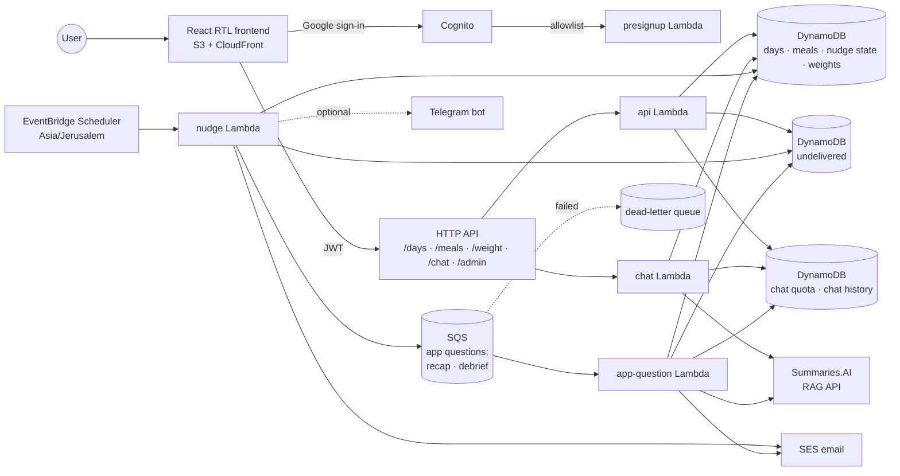

# Architecture

This document details the architecture the [README](../README.md) summarizes: every part the
stacks deploy, what the parts share, where the data lives and how the code is laid out. The
scoring, the day's lifecycle and the scheduled jobs have their own page,
[Domain rules](domain-rules.md).

**Contents:** [One body of code, several entry points](#one-body-of-code-several-entry-points) ·
[The entry points](#the-entry-points) ·
[Scoring lives in two languages](#scoring-lives-in-two-languages) ·
[Configuration both sides read](#configuration-both-sides-read) · [Storage](#storage) ·
[Codebase structure](#codebase-structure)

Nothing in this app runs between requests. The browser holds the whole user interface; each
request wakes a small Python function, which reads and writes a handful of DynamoDB tables and
then stops. Scheduled jobs wake the same way, on a clock rather than on a request. The rationale
is [ADR 0001](adr/0001-serverless-on-aws.md).

## One body of code, several entry points

The Python side is a single shared core (`src/common/`) with thin entry points in front of it
(`src/handlers/`). Every entry point deploys from the same package and reads the same tables, so
the rules live in one place; what differs between them is only when they wake and what they are
allowed to do. Splitting them this way still buys independent scaling and independent scheduling
per entry point, without splitting the rules across services.

## The entry points

- **presignup** — runs while Cognito is creating an account, and is the only thing standing
  between a Google sign-in and a new user. It matches the address against an allowlist pattern
  and turns away anything that fails
  ([ADR 0002](adr/0002-google-sign-in-behind-an-allowlist.md)); [Sign-in](sign-in.md) follows
  the whole sign-in and its Google setup. For an address that passes it
  asks SES to send its verification request — without which the sandboxed SES account cannot
  mail that address at all — and tells the admin someone new has joined.
- **api** — everything the signed-in app asks for: the day being tracked, its meals, the recorded
  history, the weight log, and the admin listing. It holds the authority over what a closed day
  may claim.
- **chat** — kept apart from `api` because it is the one feature that spends money per use, and
  because it talks to a service outside this stack, Summaries.AI
  ([ADR 0006](adr/0006-chat-through-summaries-ai.md)). It reads its API key per request from SSM
  Parameter Store, so rotating the key needs no redeploy. Its timeout is 60 seconds, twice what
  the HTTP API holds a browser's request for, because the answering service may take that long:
  when the gateway gives up on the request, the invocation keeps waiting and stores the answer,
  and the app reads it from the transcript.
- **nudge** — woken by the clock rather than by a request. It sends the day's last call and, on
  the treat-day morning, the weekly weigh-in reminder, and it queues the jobs that ask the
  answering service — the weekly recap for every user, and the morning debrief for whoever
  closed yesterday far over the heavy-day bound — one message per user, returning in seconds
  whatever the pool size.
- **app-question** — answers one queued user at a time, the message naming which job it is: for
  a recap it reads their week and the one before and asks the answering service for its reading
  of them; for a debrief it asks why yesterday fell and what today's one step is, over the
  user's recent data. Either way it stores the exchange as a chat and sends the email. Each user
  has an invocation of their own, so a slow answer delays no one else, and a crash parks that
  one user's message in a dead-letter queue instead of dropping everyone queued behind them.

## Scoring lives in two languages

The meal scoring exists twice, on purpose: `src/common/derive.py` in the backend and
`frontend/src/derive.ts` in the browser. The Python one is the authority — it re-derives a closing
day from its stored meals and refuses figures the meals do not support. The TypeScript one exists
so the day's numbers move as you type, before anything is sent.

Two implementations of one rule can drift, so both are held to the same shared test vectors in
`config/derive-vectors.json`. A change to one that the other does not match fails the suite
([ADR 0003](adr/0003-scoring-in-both-runtimes.md)).

## Configuration both sides read

`config/app.json` is the single file that describes the questions, their values, the alert
thresholds, the closing windows, the morning notifications' hour and debrief factors, and the
weekday the trend chart frames. Both runtimes read the same file: the deployed package carries it,
and the browser fetches it from the site's own origin
([ADR 0004](adr/0004-one-config-file-for-both-runtimes.md)).

One part is lifted out at deploy time rather than read at run time — the treat-day weekday and the
morning hour, because a scheduled job's timing is fixed when the stack deploys.

[Versioned configuration](domain-rules.md#versioned-configuration) specifies each element and what
depends on it.

## Storage

Seven DynamoDB tables, each holding one kind of item under plain keys, with the user's Cognito
`sub` leading the partition key (the chat quota appends the day to it): the day records, the
meals, the nudge state, the weights, the chat quota, the chat history, and the messages that
could not be delivered. There are no joins, and no table is ever scanned across users — even the
admin listing takes its list of accounts from Cognito and then reads each user's own partition.

## Codebase structure

- `src/handlers/` — the Lambda entry points: `api.py`, `chat.py`, `nudge.py` (which also holds
  the app-question consumer) and `presignup.py`.
- `src/common/` — the shared core: `store.py` and `paging.py` (DynamoDB), `derive.py` (the meal
  scoring), `questionnaire.py` and `appconfig.py` (the parsed configuration), `rules.py` (the
  alert thresholds), `weight.py`, `chat*.py` and `quota.py` (the in-app chat and its daily
  allowance), `weekly_recap.py`, `debrief.py` and `next_meal.py` (the questions the app asks
  on a user's behalf), `notify.py`, `undelivered.py` and `ses_identity.py` (delivery),
  `users.py`, `dates.py`, `log.py`, `webapi.py`.
- `tests/` — pytest against moto's AWS fakes, one file per module, plus checks of the
  templates, the scripts and the knowledge-base documents against `config/app.json`.
- `frontend/` — the React app ([ADR 0005](adr/0005-react-frontend.md)): `src/` holds the API
  client, sign-in, `derive.ts` and `components/`, each with its Vitest tests beside it; `public/`
  holds the demo page and the generated, gitignored `config.js`.
- `scripts/` — the CloudFormation templates and the operations scripts, described in
  [Development](development.md).
- `config/` — `app.json`, read by both runtimes, and `derive-vectors.json`, the scoring test
  vectors both implementations must match.
- `docs/` — this document, the topic documents, the ADRs under `docs/adr/`, and under
  `docs/kb/` the Hebrew guides the answering service answers from beside the program's own
  documents.
- `.github/workflows/ci.yml` — the CI run of both test suites; `.githooks/pre-commit` — refuses a
  commit that stages a gitignored settings file, a secret from one, or an unpublished address.
