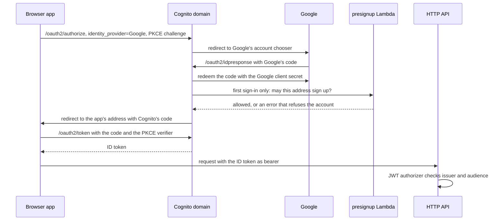

# Sign-in

People sign in to diet-tracker with a Google account, through a Cognito user pool that the
`diet-tracker-cognito` stack deploys; there is no other way in. This page explains how sign-in
works, how to set up the Google side for a new deployment and who may sign in, behind
[Architecture](architecture.md#the-entry-points). Why the app signs in this way is
[ADR 0002](adr/0002-google-sign-in-behind-an-allowlist.md).

## How it works

1. **The app sends the browser to Cognito.** The sign-in button stores a random PKCE verifier
   in the tab's `sessionStorage` and redirects to `<cognitoDomain>/oauth2/authorize` with
   `identity_provider=Google`, so Cognito skips its own page and goes straight to Google. The
   redirect URI is the app's own origin with a trailing slash (`frontend/src/auth.ts`).
2. **Google answers Cognito, not the app.** Google returns the browser to Cognito's
   `/oauth2/idpresponse`, and Cognito redeems Google's code with the client secret the stack was
   deployed with. The secret never reaches the browser.
3. **The first sign-in creates the account.** Before Cognito creates a user, it calls the
   presignup Lambda, which refuses an address that does not match the allow-list (below). A
   refusal comes back to the app as an error redirect; the app shows it in Hebrew with the admin
   address to ask for access.
4. **The app redeems Cognito's code for tokens.** Back on its own address with a one-time code,
   the app posts the code and the PKCE verifier to `/oauth2/token`, keeps the ID token in
   `sessionStorage` and drops the code from the address bar.
5. **Every API request carries the ID token.** The HTTP API's JWT authorizer accepts a token
   only when Cognito's pool issued it for this app's client; the handlers take the user id from
   the `sub` claim and the address from `email`. The app keeps no refresh token: an expired
   token returns it to its signed-out landing page.
6. **Sign-out goes through Cognito.** It clears the stored token and opens
   `<cognitoDomain>/logout`, since Cognito's own session cookie would otherwise sign the same
   Google account straight back in.

The Cognito domain, the app client id and the API address reach the browser in
`frontend/public/config.js`, which every backend deploy writes from the stacks' outputs.

## Setting up Google

Do this once, before the first deploy, since the Cognito stack is deployed with the client's id and
secret. The steps start from no Google Cloud project.

1. **Create a project.** In the [Google Cloud console](https://console.cloud.google.com/), choose
   **New project** in the project picker, name it `diet-tracker` and select it.
2. **Set up the consent screen.** Open **Google Auth Platform** and click **Get started**. Give an
   app name and your email, choose **External**, and finish with **Create**.
3. **Add the test users.** Under **Audience → Test users**, add every Google account that will sign
   in, your own included.
4. **Print the redirect URI.** Run `./scripts/aws-helper.sh --redirect-uri`. It needs only
   `scripts/lib/aws-config.sh` filled in.
5. **Create the client.** Under **Clients → Create client**, choose **Web application** and add the
   URI of step 4 under **Authorized redirect URIs**.
6. **Store the id and secret.** Copy them into `GOOGLE_CLIENT_ID` and `GOOGLE_CLIENT_SECRET` in
   `scripts/lib/secrets.sh`.

A feature branch deploys its own Cognito domain: run step 4 on that branch and add its URI to the
same client. Google may take a few minutes to apply a new URI; until then, sign-in ends on a
`redirect_uri_mismatch` page.

Cognito alone talks to Google, so the client needs no other address. The app's own addresses,
`http://localhost:8000/` and the CloudFront address, are callback URLs of the Cognito app client,
which the deploy registers. To reuse a client you already have, add the URI of step 4 to it.

## Who may sign in

Two lists apply, and an address must pass both.

- **Google's audience.** While the app is in **Testing**, Google signs in only the accounts
  listed under **Audience → Test users**, up to 100, and shows any other account an "access
  blocked" page. To open sign-in to every Google account, choose **Publish app** under
  **Audience**; with no scopes beyond `openid email profile`, Google publishes it without a
  verification review.
- **The sign-up allow-list.** `ALLOWED_EMAILS` in `scripts/lib/params.sh` is a regex a new
  account's address must match in full, ignoring case: join addresses with `|` to name several,
  or set `.*` to admit everyone. The presignup Lambda reads it on each new account, so it
  gates sign-up, not sign-in: an account already in the pool stays when the regex changes. A
  change takes a backend deploy.

`ADMIN_EMAIL` in `params.sh` receives a mail about each new account, and refused people see it as
the address to ask for access.
